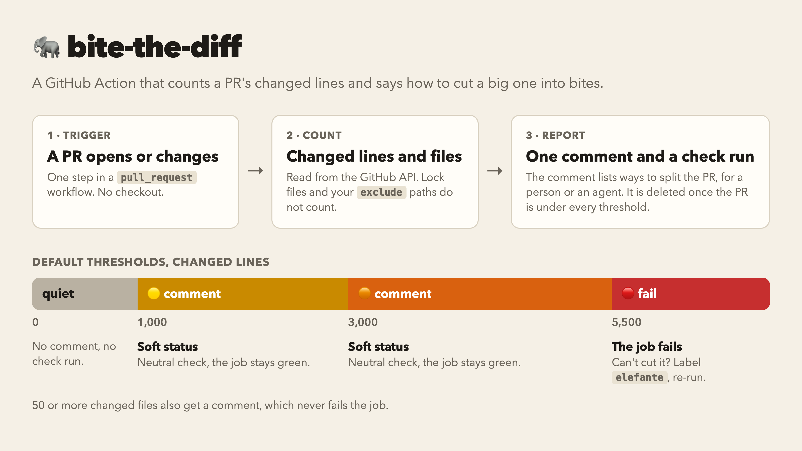

<h1 align="center">bite-the-diff</h1>

<p align="center">
  <a href="https://github.com/drakulavich/bite-the-diff/actions/workflows/ci.yml"></a>
  <a href="https://opensource.org/licenses/MIT"></a>
  <a href="https://nodejs.org"></a>
</p>

<p align="center"><b>🐘 bite-the-diff is a GitHub Action that counts a PR's changed lines and files and, when the PR is too big to review, comments on it with ways to cut it into bites and turns its check red past a hard limit.</b></p>

<picture>
  <source media="(prefers-color-scheme: dark)" srcset="docs/explainer-dark.png">
  
</picture>

## In thirty seconds

Add one step to a workflow that already runs on `pull_request`. The action works from the API alone, so it needs no checkout.

```yaml
on: pull_request
jobs:
  build:
    runs-on: ubuntu-latest
    permissions:
      contents: read
      pull-requests: write
      checks: write
    steps:
      - uses: drakulavich/bite-the-diff@v1
      # your other steps
```

Job-level `permissions` replace the workflow's, so list what your other steps need too. With the defaults:

- **From 1000 lines, and again from 3000**: one comment with the ways to split the PR and a `neutral` check run. The job stays green.
- **From 50 files**: the same kind of comment, and it never fails the job.
- **From 5500 lines**: the check run and the job go red, and later steps are skipped, so put the step first. To let such a PR through, add the label `elefante`, then press Re-run. The action reads labels and the head commit from the API, so a re-run sees the label and writes to the live head.
- **Lock files** in any folder do not count, and a stacked PR whose base is its parent branch counts only its own diff.
- **Under every threshold**: no comment, and a comment from an earlier run is deleted. While the PR stays over a threshold, every run updates the same comment in place.

## What it posts

A person or an agent finds the result on the PR with nothing else installed: the comment among its comments, and the check run in its checks and in `gh pr checks`. A PR of 1240 lines gets a check run named `bite-the-diff 🟡 1240 lines` and this comment, with the ways to split it in a collapsed list:

> 🟡 **1240 lines.** That's a lot of elephant for one bite (threshold: 1000).
>
> <details>
> <summary>🐘 Ways to cut it into bites</summary>
>
> - **Stack:** land a small change and base the next PR on it: `git switch -c`, `gh pr create --base <parent branch>`. When the parent merges, retarget and rebase the child before deleting the parent's branch: deleting it first closes the child. For parts that depend on each other in sequence.
> - **By file group:** separate PRs for files that need different reviewers. For a change that cuts across areas.
> - **Horizontal:** shared code or stubs first, then what uses them. For layered code.
> - **Vertical:** smaller slices of the feature, each working end to end. For feature work.
> - **Refactoring apart:** refactoring in its own PR, before the behaviour change. For a PR that mixes the two.
> - **Leave it whole:** add the path to `exclude`. For whole-file deletions, generated code and automated refactoring, where a reviewer only checks intent.
> </details>
>
> <sub>🐘 [bite-the-diff](https://github.com/drakulavich/bite-the-diff)</sub>

### Outcomes

With the default thresholds:

| Lines | Comment | Check run | Job |
|---|---|---|---|
| under 1000, no comment yet | none | none; an existing one becomes `success`, `bite-the-diff 40 lines` | green |
| under 1000, a comment exists | deleted | as above | green |
| 1000 to 2999 | created or updated | `neutral`, `bite-the-diff 🟡 1240 lines` | green |
| 3000 to 4999 | created or updated | `neutral`, `bite-the-diff 🟠 3100 lines` | green |
| 5000 to 5499 | created or updated, says where red starts; the bypass label has no effect | `neutral`, `bite-the-diff 🟠 5200 lines` | green |
| 5500 or more | created or updated, names the bypass label | `failure`, `bite-the-diff 🔴 5600 lines` | red |
| 5500 or more, with the bypass label | created or updated, says the label let it pass | `neutral`, `bite-the-diff 🟠 5600 lines` | green |

The default file threshold adds to that table:

| Files | Lines | Comment | Check run | Job |
|---|---|---|---|---|
| 50 or more | under 1000 | created or updated: `🟡 **63 files.** A lot of elephant to chew at once (threshold: 50).` | `neutral`, `bite-the-diff 🟡 63 files` | green |
| 50 or more | 1000 or more | the comment for those lines, plus the line `Also 63 files (threshold: 50).` | the check run for those lines, with the files in the name: `bite-the-diff 🟠 3100 lines, 63 files` | the job for those lines |

A PR has at most one comment from this action and a commit at most one check run. A run over a threshold after the comment was deleted creates a new one. `gh pr checks` lists a `neutral` check as `skipping`, so `skipping` does not mean the action did not run.

## Tuning

### Inputs

| Input | Default | Meaning |
|---|---|---|
| `thresholds` | `1000:comment`, `3000:comment`, `5000:fail`, one per line | Lines and action per threshold. A `fail` threshold has a 10% tolerance, rounded up: `5000:fail` goes red from 5500. `comment` thresholds have none |
| `file-threshold` | `50` | Files that get a comment, counted after `exclude`. It never fails the job and the bypass label has no effect on it. `0` turns it off |
| `exclude` | empty | Globs of paths left out of the count, one per line, on top of the built-in lock files |
| `bypass-label` | `elefante` | This label lets a PR past a `fail` threshold pass |
| `token` | `${{ github.token }}` | `pull-requests: write` for the comment and `checks: write` for the check run; without them the result stays in the job summary |

Only the highest threshold reached applies: with `1000:fail` and `5000:comment`, 6000 lines only comment. The lowest `comment` threshold gets 🟡, every other soft status 🟠, and a `fail` without the label 🔴. Set `thresholds` lower if your reviews slow down on PRs under the defaults.

### What is not counted

| Left out | Rule |
|---|---|
| Lock files, in any folder | `package-lock.json`, `npm-shrinkwrap.json`, `yarn.lock`, `pnpm-lock.yaml`, `bun.lock`, `bun.lockb`, `Cargo.lock`, `go.sum`, `poetry.lock`, `uv.lock`, `Pipfile.lock`, `composer.lock`, `Gemfile.lock`, `gradle.lockfile`, `buildscript-gradle.lockfile`. The list cannot be turned off |
| Paths in `exclude` | Your own globs, such as generated code. `**/` matches a path at the root and in any folder; a bare `generated.ts` matches only the root |

Everything else counts, deleted lines and removed files included.

### Outputs

| Output | Meaning |
|---|---|
| `lines` | Changed lines counted |
| `level` | The action of the threshold reached: `none`, `comment` or `fail`. A bypassed PR still reports `fail`, a PR inside a `fail` threshold's tolerance `comment`. A PR that reached only the file threshold reports `comment` |
| `files` | Changed files counted |

### How it reports, and how to make it binding

- **Job summary**: always gets one line with the count and the level.
- **Without write permissions**: without `pull-requests: write` there is no comment, and without `checks: write` no check run. The result then stays in the job summary and in a warning that names the permission to add. A PR past a `fail` threshold still fails its job. This was tried on public repos only.
- **`continue-on-error: true`**: later steps run and the job is green, but the check run keeps the PR red when the token can write checks. A required check on that job then passes.
- **A binding limit**: require the job, which fails only past a `fail` threshold. The check run's name changes with the size, so it cannot be a required check.

### A separate workflow, for a label that acts without a re-run

A step in an existing workflow needs no `concurrency` block. This workflow runs on label events too, and it needs one:

```yaml
# .github/workflows/bite-the-diff.yml 
name: bite-the-diff
on:
  pull_request:
    types: [opened, synchronize, reopened, labeled, unlabeled]
concurrency:
  group: bite-the-diff-${{ github.event.pull_request.number }}
  queue: max
permissions:
  pull-requests: write
  checks: write
jobs:
  bite-the-diff:
    runs-on: ubuntu-latest
    steps:
      - uses: drakulavich/bite-the-diff@v1
```

`labeled` and `unlabeled` make the check follow the bypass label. Adding several labels at once starts one run per label. The `concurrency` group makes the runs for one PR take turns, so they do not race to create two comments. A group keeps one pending run by default and cancels the rest; `queue: max` keeps up to 100 waiting, so no run ends `CANCELLED`. Some actionlint versions reject the `queue` key.

## Limits

- **Forks**: a PR from a fork gets a read-only token, so its result is only in the job summary and in warnings. A fork PR past a `fail` threshold still fails its job, which can block a required check.
- **3000 files**: `GET /pulls/{n}/files` lists at most 3000 files. Above that, the line and file counts are the PR's totals, without `exclude`, lock files included, and the comment says so.
- **Stacked PRs**: after a squash merge, deleting the parent's branch with `gh pr merge --squash --delete-branch` or through the API closed its child for good, and the child could then be neither reopened nor retargeted. The web button and the auto-delete setting were not tried. Before you delete the branch, retarget the child and rebase it onto the squash commit; retargeted without the rebase, it also counts its parent's lines.
- **403**: if the token gets a 403 on writing or deleting the comment or on the check run, the action logs a warning that names the permission, adds it to the job summary and carries on, and a PR past a `fail` threshold still fails its job.
- **API failures**: each request has a 30 s timeout and 2 retries on 429, 5xx and network errors. Once those are spent, a failed read leaves a warning, no outputs and a green step, so an outage does not block a PR. A failed write leaves a warning, and a PR already counted past a `fail` threshold still fails its job. A retried write that had in fact gone through can leave a second comment. A 401 and any other 4xx fail the job.
- **2 minutes**: after 2 minutes the action stops its requests and reports as for any other API failure, so the job needs no `timeout-minutes`.
- **Merge conflicts**: GitHub does not run `pull_request` workflows while a PR has a merge conflict, so the check waits until it is resolved.
- **`ubuntu-slim`**: works, a few seconds slower than `ubuntu-latest`.

## Why it exists

You eat an elephant one bite at a time. Agents tend to pile all the work into one PR, and nothing tells them to stop.

## Contributing

```sh
bun install
bun run check   # typecheck, lint and tests
bun run build   # writes dist/index.mjs
```

`dist/index.mjs` is committed, and CI rebuilds it and fails if it is not fresh. CI also runs the action on its own PR and checks the check run and the comment it posts and deletes.

The code in `src/` runs on the runner's Node, so it uses only `node:*`, web APIs and bundled packages. `tsconfig.json` makes `Bun.*` in `src/` a type error.

## License

Made with 🐘 under [MIT License](LICENSE).
